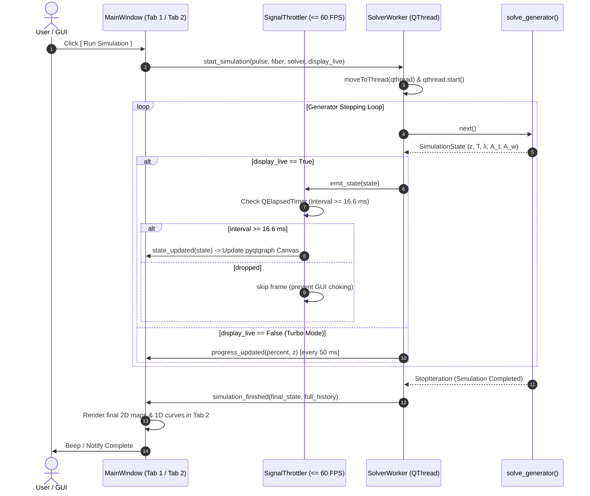

# GNLSE Pulse Propagation Simulator — GUI & System Blueprint

> **Document ID:** GNLSE-GUI-SPEC-001  
> **Status:** APPROVED & SPECIFIED  
> **Lead Author:** `gui-layout-dev`  

---

## 1. System Architecture & UI Philosophy

The GNLSE Desktop Simulator is designed around **strict domain separation** and **decoupled concurrency**:
1. **Zero Physics in GUI**: The UI never directly runs numerical equations; it communicates exclusively through a strongly-typed `WorkerBridge` with `src/solver/`.
2. **Tabbed Workflow Separation**: Three distinct functional views:
   - **Tab 1: Control & Setup**: All parameter inputs, `.h5`/`.csv` dispersion file navigator, and execution controls.
   - **Tab 2: Results & Visualization**: Dynamic pyqtgraph plotting canvas tailored to the active simulation mode, with one-click export tooling.
   - **Tab 3: System Logging**: Real-time diagnostic terminal, step performance metrics, and conservation audit logs.
3. **Decoupled Concurrency Bridge**: A dedicated `QThread` runs the numerical generator. A hardware-aware signal throttler limits GUI redraws to $\le 60\text{ FPS}$ when live streaming is enabled, and can bypass UI rendering entirely if full-speed batch mode is selected.

---

## 2. Three-Tab Workstation Layout

```text
┌────────────────────────────────────────────────────────────────────────────────────────┐
│  GNLSE Simulator — High Performance Laboratory                                   [-][x]│
├────────────────────────────────────────────────────────────────────────────────────────┤
│  [ TAB 1: Setup & Execution ]  [ TAB 2: Results & Plots ]  [ TAB 3: System Logging ]   │
├────────────────────────────────────────────────────────────────────────────────────────┤
│                                                                                        │
│  <TAB CONTENT RENDERED BELOW>                                                          │
│                                                                                        │
├────────────────────────────────────────────────────────────────────────────────────────┤
│  Status: Idle | Step: 0 / 1000 | z: 0.00 cm / 10.00 cm | Progress: [======== 0% ]     │
└────────────────────────────────────────────────────────────────────────────────────────┘
```

---

## 3. Tab 1: Setup, Control & File Navigation

Tab 1 is split into a **Two-Column Layout**:
- **Left Column**: Parameter Input Cards & Execution Toolbar.
- **Right Column**: Interactive `.h5` and `.csv` Dispersion File Navigator & Preview.

### 3.1 Parameter Input Cards (Left Column)

1. **Simulation Type & Numerical Method Card**:
   - `Simulation Type` dropdown:
     - `"Spectrum vs Distance"`: Standard continuous propagation along fiber length $L$.
     - `"Spectrum vs Power"`: Parametric pump power sweep from $P_{\min}$ to $P_{\max}$ at fixed fiber length $L$.
   - `Split-Step Method` dropdown:
     - `"RK4IP"` (4th-Order Runge-Kutta in Interaction Picture — recommended).
     - `"S-SSFM"` (Symmetrized Split-Step Fourier Method).
     - `"SSFM"` (Standard Split-Step Fourier Method).
   - `Adaptive Step Control`:
     - Toggle checkbox: `[x] Adaptive Step Size`.
     - Fields: Initial step $h_{\text{init}}$ (m), Error Tolerance $\text{tol}$ (e.g. $10^{-5}$), Minimum step $h_{\min}$ (m).

2. **Input Pulse Card**:
   - `Shape` dropdown: `Sech`, `Gaussian`, `Custom Array`.
   - `Duration FWHM`: $T_{\text{FWHM}}$ (fs) (with automatic $T_0$ display).
   - `Peak Power`: $P_0$ (W or kW) (or $P_{\min}$, $P_{\max}$, and $N_{\text{steps}}$ in Power Sweep mode).
   - `Center Wavelength`: $\lambda_0$ (nm) (with carrier frequency $\omega_0$ display).
   - `Chirp Parameter`: $C$ (linear chirp).

3. **Fiber & Dispersion Card**:
   - `Length`: $L$ (m or cm).
   - `Nonlinear Coefficient`: $\gamma$ ($\text{W}^{-1}\text{km}^{-1}$ or $\text{W}^{-1}\text{m}^{-1}$).
   - `Attenuation Loss`: $\alpha$ (dB/km).
   - `Raman Response`: Toggle `[x] Enable Raman` with $f_R = 0.18$, $\tau_1 = 12.2\text{ fs}$, $\tau_2 = 32.0\text{ fs}$.
   - `Shock / Self-Steepening`: Toggle `[x] Enable Self-Steepening` ($1 + \Omega/\omega_0$).
   - `Dispersion Input Mode` dropdown:
     - **Mode A: Manual Input ($\beta_2$ through $\beta_7$)**:
       - 6 input fields with unit conversion toggles ($\text{ps}^k/\text{km} \leftrightarrow \text{s}^k/\text{m}$):
         - $\beta_2$ ($\text{ps}^2/\text{km}$), $\beta_3$ ($\text{ps}^3/\text{km}$), $\beta_4$ ($\text{ps}^4/\text{km}$), $\beta_5$ ($\text{ps}^5/\text{km}$), $\beta_6$ ($\text{ps}^6/\text{km}$), $\beta_7$ ($\text{ps}^7/\text{km}$).
     - **Mode B: Import Dispersion File**:
       - Displays currently selected file path from File Navigator.

4. **Execution Toolbar & Live Streaming Control**:
   - `[x] Display as the simulation runs` checkbox:
     - **Checked**: Concurrency bridge throttles updates to $\le 60\text{ FPS}$, updating Tab 2 plots in real time.
     - **Unchecked (Turbo Mode)**: Worker runs at maximum numerical throughput without GUI rendering latency, immediately switching to Tab 2 and rendering final plots upon completion.
   - Buttons:
     - `[ ▶ Run Simulation ]` (Primary Green)
     - `[ ❚❚ Pause / Resume ]` (Warning Yellow)
     - `[ ⏹ Abort ]` (Danger Red)

### 3.2 File Navigator & Inspector (Right Column)

An intuitive, dedicated file browser for managing and previewing experimental/simulated fiber dispersion data:
- **Directory Tree / File List**:
  - Automatically filters and highlights supported files: **`.h5`** (HDF5) and **`.csv`**.
  - Quick buttons: `[ 📁 Browse Folder ]`, `[ 🔄 Refresh ]`, `[ ＋ Add File ]`.
- **File Metadata & Dataset Inspector**:
  - For `.h5`: Tree view showing HDF5 groups, datasets, attributes, array shapes, and columns.
  - For `.csv`: Table preview showing headers (e.g. `wavelength_nm`, `D_ps_nm_km`, `beta2`, `loss_db`).
- **Live Preview Curve**:
  - pyqtgraph canvas rendering the selected dispersion profile $D(\lambda)$ [ps/(nm·km)] or $\beta(\omega)$ with Zero Dispersion Wavelength (ZDW) crosshairs.
  - `[ Use as Active Dispersion ]` button: loads the curve directly into `DispersionConfig`.

---

## 4. Tab 2: Results & Visualization Canvas

The output canvas dynamically adapts its layout based on the active **Simulation Type** selected in Tab 1, matching the exact reference specifications:

### 4.1 Mode A: "Spectrum vs Distance" Layout (2 × 2 Grid)

Matching the designated laboratory layout:
```text
┌───────────────────────────────────────┬───────────────────────────────────────┐
│ Time Domain 2D Density Map            │ Freq. Domain 2D Density Map           │
│ • Y-axis: Distance [cm] (0 to L)      │ • Y-axis: Distance [cm] (0 to L)      │
│ • X-axis: Time [ps] (-2.5 to +2.5)    │ • X-axis: Wavelength [nm] (500-1200)  │
│ • Intensity: dB normalized (-40 to 0) │ • Intensity: dB normalized (-40 to 0) │
│ ───────────────────────────────────── │ ───────────────────────────────────── │
│ [Colorbar: -40 to 0 dB]               │ [Colorbar: -40 to 0 dB]               │
├───────────────────────────────────────┼───────────────────────────────────────┤
│ Time Domain 1D Intensity              │ Freq. Domain 1D Spectral Power        │
│ • Y-axis: Intensity (Linear W or norm)│ • Y-axis: Spectral Power [dB] (-200..0│
│ • X-axis: Time [ps] (-0.5 to +0.5)    │ • X-axis: Wavelength [nm] (500-1200)  │
│ • Curves:                             │ • Curves:                             │
│   — Blue: "before" (Input at z=0)     │   — Blue: "before" (Input at z=0)     │
│   — Orange: "after" (Current z)       │   — Orange: "after" (Current z)       │
└───────────────────────────────────────┴───────────────────────────────────────┘
```

1. **Top-Left (Time Domain 2D Map)**:
   - Real-time `pg.ImageItem` showing temporal pulse evolution $|A(z, T)|^2$ in log dB scale.
   - Shows pulse compression, soliton fission, and walk-off trajectories.
2. **Top-Right (Freq. Domain 2D Map)**:
   - Real-time `pg.ImageItem` showing spectral power $|\tilde{A}(z, \lambda)|^2$ in log dB scale.
   - Shows self-phase modulation broadening, dispersive wave generation (400–600 nm), and Raman soliton self-frequency shift (> 1000 nm).
3. **Bottom-Left (Time Domain 1D Line Plot)**:
   - Two line curves: `before` (blue initial pulse) and `after` (orange propagated pulse at current distance $z$).
   - Interactive zoom/pan over sub-picosecond structure.
4. **Bottom-Right (Freq. Domain 1D Line Plot)**:
   - Two line curves: `before` (blue input pump spectrum) and `after` (orange output supercontinuum spectrum in dB down to $-200\text{ dB}$).

### 4.2 Mode B: "Spectrum vs Power" Layout (1 × 2 Grid)

In pump power sweep mode, all time-domain plots are automatically hidden, leaving a clean, focused spectral analysis workstation:
```text
┌───────────────────────────────────────┬───────────────────────────────────────┐
│ 2D Power-Sweep Spectral Density Map   │ 1D Spectral Power (Current vs Initial)│
│ • Y-axis: Peak Power P₀ [kW]          │ • Y-axis: Spectral Power [dB] (-200..0│
│ • X-axis: Wavelength [nm] (500-1200)  │ • X-axis: Wavelength [nm] (500-1200)  │
│ • Intensity: dB normalized (-40 to 0) │ • Curves:                             │
│ ───────────────────────────────────── │   — Blue: "before" (Input spectrum)   │
│ [Colorbar: -40 to 0 dB]               │   — Orange: "after" (Output at P₀)    │
└───────────────────────────────────────┴───────────────────────────────────────┘
```
- **Left**: 2D color density map showing spectral emergence as peak power $P_0$ is scaled from $P_{\min}$ to $P_{\max}$ at the fiber output $z = L$.
- **Right**: High-resolution 1D spectral overlay comparing output at the selected power against the input spectrum.

### 4.3 Canvas Header & Export Tooling
- **Canvas Top Bar**:
  - Simulation title banner: `"Simulation with [Method] method — [Mode]"`.
  - Colormap selector: `[ viridis ▼ ]` (`viridis`, `inferno`, `magma`, `plasma`, `jet`).
  - Colorbar floor slider: dynamic range cutoff adjustment from $-20\text{ dB}$ to $-80\text{ dB}$.
  - `[ 💾 Export Results ]` Button:
    - Opens export dialog with choices:
      1. **Save Publication Figures**: High-resolution PNG / PDF / SVG snapshot.
      2. **Save Numerical Data**: Complete simulation state matrix ($T, \lambda, z, P_0, A(z,T), \tilde{A}(z,\lambda)$) exported as **HDF5 (`.h5`)** or **CSV (`.csv`)**.

---

## 5. Tab 3: System Logging & Real-time Diagnostics

Tab 3 provides a comprehensive numerical health and concurrency monitor:
1. **Interactive Console Log**:
   - Real-time logging terminal with timestamps and severity tags (`[INFO]`, `[STEP]`, `[WARN]`, `[ERROR]`).
   - Displays step-by-step progress, adaptive step adjustments ($h$ increased/decreased), and simulation milestones.
2. **Conservation Metrics Dashboard**:
   - Live numeric readouts and mini sparkline graphs:
     - **Relative Energy Conservation**: $|E(z) - E(0)| / E(0)$ (target $< 10^{-10}$ for conservative tests).
     - **Relative Photon Conservation**: $|N_{\text{ph}}(z) - N_{\text{ph}}(0)| / N_{\text{ph}}(0)$ (target $< 10^{-3}$ for Raman SCG).
     - **Adaptive Step Size**: Current $h(z)$ (m) and acceptance ratio.
     - **Computation Performance**: Steps per second and estimated time of arrival (ETA).
3. **Log Controls**:
   - `[ Clear Logs ]`, `[ Copy to Clipboard ]`, `[ Save Log to File (.txt) ]`.

---

## 6. Decoupled Concurrency Bridge (`src/bridge/`)



### 6.1 Concurrency & Lifecycle Guarantees
1. **Thread Separation**: All numerical computations execute exclusively on `SolverWorker` in a separate `QThread`. No solver computation touches the main GUI thread.
2. **Cooperative Cancellation**:
   - An atomic flag `_is_interrupted` is checked on every generator step.
   - When the user clicks **Abort** or closes the application window, `worker.abort()` sets the flag, and the worker thread joins within 1000 ms via `thread.wait()`.
   - Guaranteed **zero dangling threads** and elimination of `QThread: Destroyed while thread is still running`.
3. **Hardware-Aware Throttling**:
   - `SignalThrottler` enforces a minimum interval of $16.6\text{ ms}$ ($\le 60\text{ FPS}$) using `QElapsedTimer`.
   - If the solver generates 2,000 steps per second, ~1,940 intermediate visual frames are safely dropped, while the progress bar and step counter update accurately.

---

## 7. Software Implementation Map

```text
src/
├── bridge/
│   ├── __init__.py
│   ├── worker.py              # SolverWorker (QThread) & cooperative abort
│   └── throttler.py           # SignalThrottler (60 FPS cap & turbo bypass)
└── gui/
    ├── __init__.py
    ├── main_window.py         # QMainWindow with 3-tab layout
    ├── tab_controls.py        # Tab 1: Parameter cards & live checkbox
    ├── tab_results.py         # Tab 2: 2x2 or 1x2 pyqtgraph canvas & export dialog
    ├── tab_logging.py         # Tab 3: Diagnostic log terminal & conservation readouts
    ├── file_navigator.py      # Tab 1: .h5 and .csv dispersion browser & inspector
    └── plots.py               # pyqtgraph custom plot widgets & colormap utilities
```

---

## 8. Verification & Acceptance Criteria (Software Gate)

1. **Headless Execution**:
   - All tabs, widgets, and bridges must instantiate and pass tests headlessly:
     ```bash
     QT_QPA_PLATFORM=offscreen pytest -v tests/test_gui_headless.py tests/test_bridge_headless.py
     ```
2. **Mode Switching Test**:
   - Toggling from `"Spectrum vs Distance"` to `"Spectrum vs Power"` must dynamically restructure Tab 2 from 2x2 to 1x2 without widget leakage or memory growth.
3. **Turbo vs Live Mode Test**:
   - Verify that when `[x] Display as the simulation runs` is unchecked, zero `state_updated` signals are processed by the canvas until `simulation_finished` is received.
4. **Clean Teardown**:
   - Aborting a simulation mid-run must cleanly terminate the thread in $< 500\text{ ms}$ with no unhandled exceptions.

---

## 9. Scientific Typography, Unit Integrity & Plot Formatting Standards

Strict compliance with SI/engineering unit notation and peer-reviewed scientific typography is mandatory across all views:

### 9.1 Parameter Controls & Input Labels (Tab 1)
Every parameter label MUST have its physical unit explicitly written in brackets:
- **Pulse Parameters**:
  - `Duration: Pulse FWHM [fs]`
  - `Peak Power: P₀ [W]` (or `[kW]`)
  - `Wavelength: Carrier λ₀ [nm]`
  - `Chirp: Parameter C [-]` (dimensionless)
- **Fiber Parameters**:
  - `Length: Fiber Length L [cm]` (or `[m]`)
  - `Nonlinearity: Gamma γ [W⁻¹·km⁻¹]` (with SI `[W⁻¹·m⁻¹]` conversion tooltip)
  - `Loss: Linear Attenuation α [dB/km]`
  - `Raman: Fraction f_R [-]`, `Oscillation τ₁ [fs]`, `Damping τ₂ [fs]`
- **Taylor Dispersion Coefficients**:
  - `β₂ [ps²/km]`
  - `β₃ [ps³/km]`
  - `β₄ [ps⁴/km]`
  - `β₅ [ps⁵/km]`
  - `β₆ [ps⁶/km]`
  - `β₇ [ps⁷/km]`
- **Numerical Grid**:
  - `Grid Size: N [points]` (power of 2)
  - `Time Window: T_max [ps]`
  - `Initial Step: h_init [mm]` (or `[m]`)
  - `Tolerance: tol [-]`

### 9.2 Plot Titles, Axes & Legends (Tab 2)
All plots MUST use rigorous, publication-grade scientific labeling:
- **Master Canvas Banner**:
  - `"Simulation with [Method] Method — [Simulation Type]"` (e.g. `Simulation with RK4IP Method — Spectrum vs Distance`)
- **2D Time Domain Color Map**:
  - Subplot Title: `Time domain`
  - Y-Axis Label: `Distance [cm]`
  - X-Axis Label: `Time [ps]`
  - Colorbar Label: `Normalized Intensity [dB]` (scale: $-40$ to $0\text{ dB}$)
- **2D Frequency Domain Color Map**:
  - Subplot Title: `Freq. domain`
  - Y-Axis Label: `Distance [cm]`
  - X-Axis Label: `Wavelength [nm]`
  - Colorbar Label: `Normalized Spectral Density [dB]` (scale: $-40$ to $0\text{ dB}$)
- **1D Time Domain Profile**:
  - Y-Axis Label: `Intensity [W]` (or `Normalized Intensity [-]`)
  - X-Axis Label: `Time [ps]`
  - Legend Labels: `before (Input at z = 0)` / `after (Output at z = L)`
- **1D Spectral Domain Profile**:
  - Y-Axis Label: `Spectral Power [dB]`
  - X-Axis Label: `Wavelength [nm]`
  - Legend Labels: `before (Input at z = 0)` / `after (Output at z = L)`
- **Power Sweep Mode (Spectrum vs Power)**:
  - 2D Map Y-Axis: `Peak Power P₀ [kW]`
  - 2D Map X-Axis: `Wavelength [nm]`
  - 1D Line Y-Axis: `Spectral Power [dB]`
  - 1D Line X-Axis: `Wavelength [nm]`
- **Diagnostics & Metrics (Tab 3)**:
  - Energy Error: `Relative Energy Error |ΔE(z)/E(0)| [-]`
  - Photon Error: `Relative Photon Error |ΔN_ph(z)/N_ph(0)| [-]`
  - Execution Speed: `Calculation Rate [steps/s]`
  - Step Size: `Step Size h(z) [μm]` or `[mm]`

