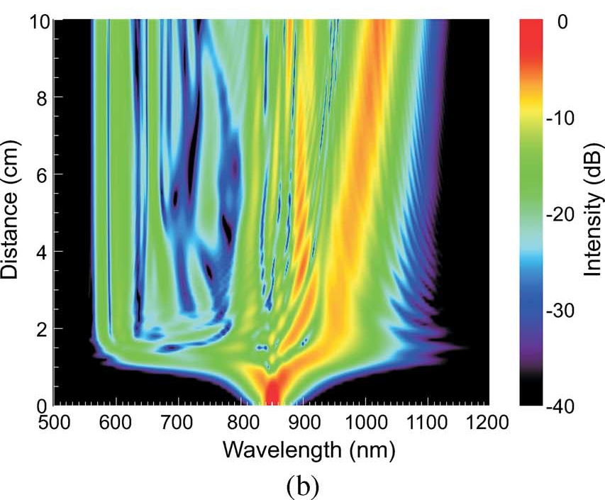
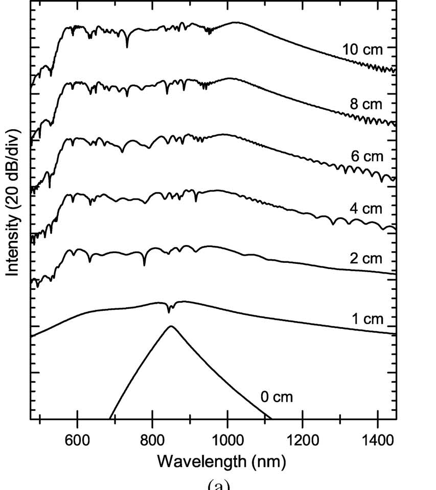
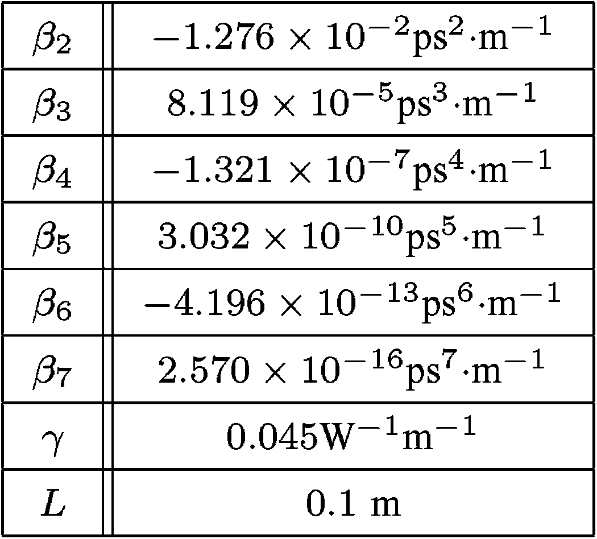
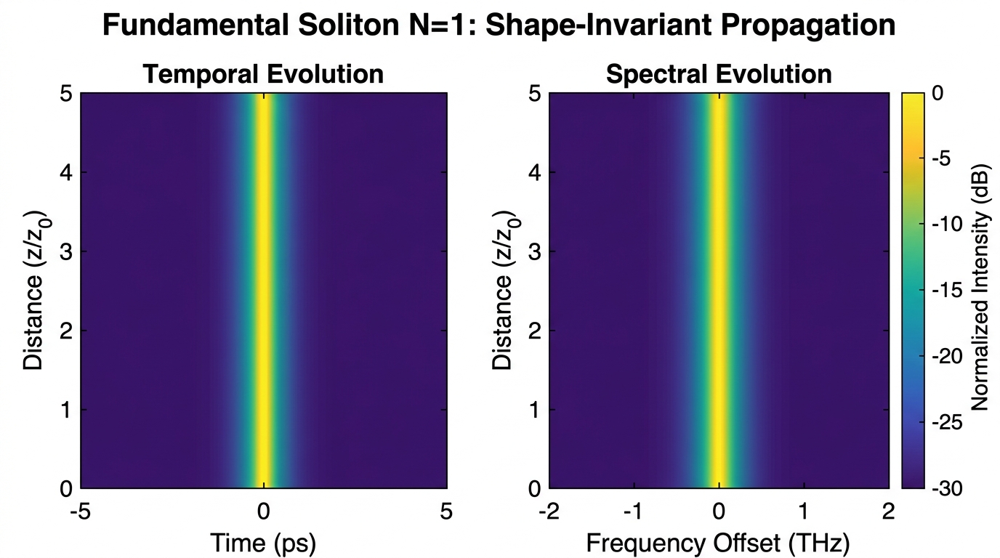
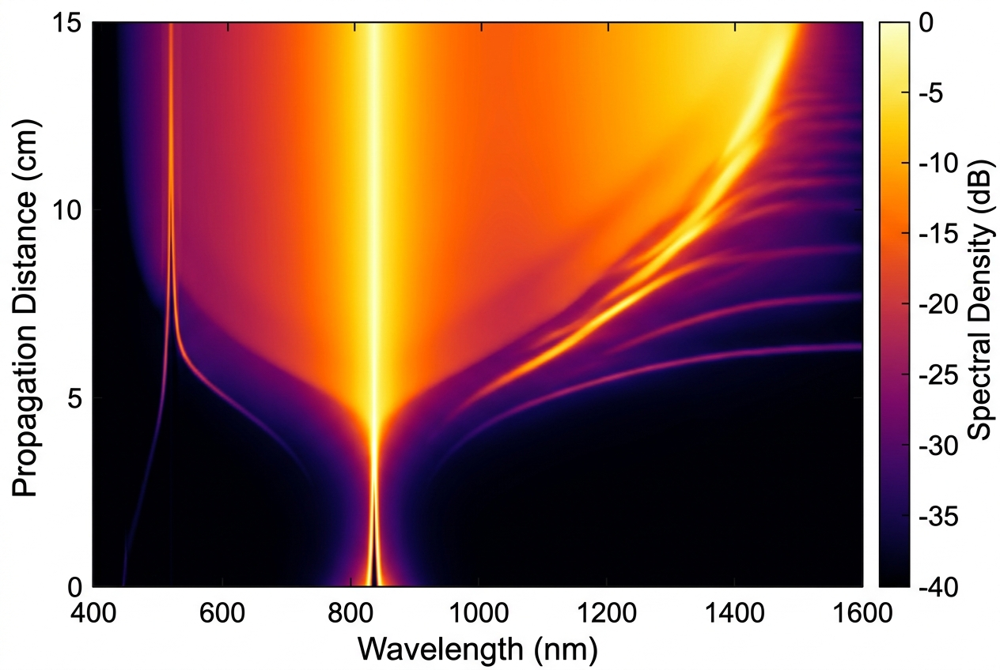
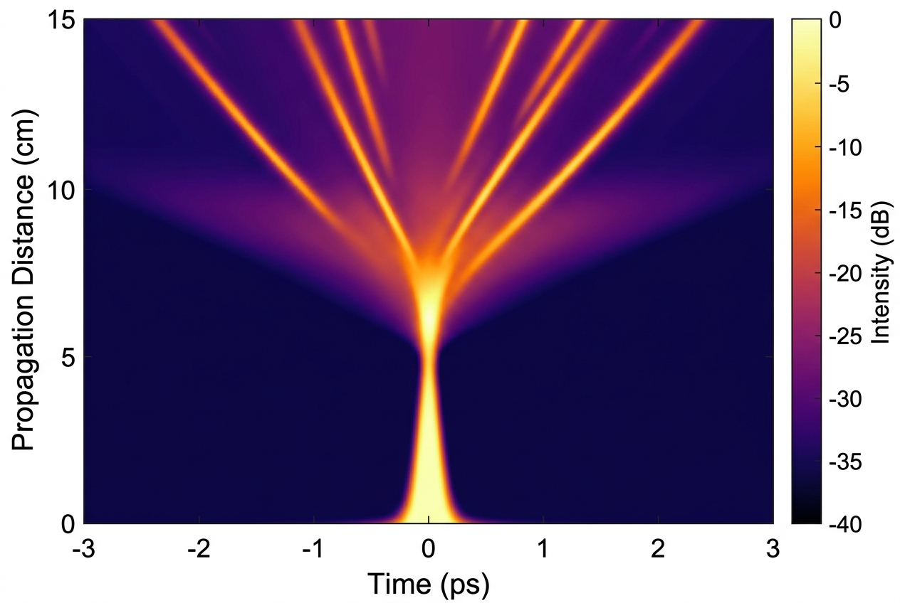

# GNLSE Simulation — Visual Reference Guide

## Purpose
This folder contains reference images and data for direct visual comparison
with GNLSE simulation output. The simulation produces 2D color maps (density plots)
showing spectral or temporal evolution as a function of propagation distance.

---

## 🎯 Primary Validation Milestone: Johan Hult (2007) PCF Supercontinuum

> **Paper:** Johan Hult, *"A Fourth-Order Runge–Kutta in the Interaction Picture Method for Simulating Supercontinuum Generation in Optical Fibers"*, IEEE Journal of Lightwave Technology, Vol. 25, No. 12, pp. 3770–3775, December 2007.  
> **PDF Location:** `reference_data/A_Fourth-Order_RungeKutta_in_the_Interaction_Picture_Method_for_Simulating_Supercontinuum_Generation_in_Optical_Fibers.pdf`

This benchmark represents the **canonical milestone** for the simulator: reproducing the exact 2D spectral evolution density plot published in the seminal paper that introduced the RK4IP algorithm to nonlinear optics.

### 1. Milestone 2D Density Map (Figure 2b)

**File:** `figures/ref_hult_2007_fig2b_density_map.png`



#### Direct Comparison Checklist:
- **x-axis (Wavelength):** 500 nm to 1200 nm
- **y-axis (Distance):** 0 cm to 10 cm (0.1 m)
- **Color Scale:** Logarithmic spectral density, truncated at **-40 dB** relative to the peak value (rainbow / jet colormap in original, or `inferno`/`turbo`)
- **Initial Stage ($z < 1\text{ cm}$):** Rapid symmetric spectral broadening centered at 850 nm due to SPM and anomalous dispersion.
- **Fission Region ($z \sim 1.2 - 1.5\text{ cm}$):** Soliton fission occurs; the symmetric spectrum breaks into distinct discrete solitons.
- **Red-Shifted Soliton ($z > 2\text{ cm}$):** A prominent fundamental soliton emerges on the long-wavelength side and continuously self-shifts (SSFS via Raman scattering) reaching $\approx 1100 - 1150\text{ nm}$ at $z = 10\text{ cm}$.
- **Blue-Shifted Dispersive Waves ($z > 2\text{ cm}$):** Multiple sharp spectral features shed as Cherenkov radiation on the short-wavelength side between 550 nm and 650 nm.

---

### 2. Milestone Spectral Slices (Figure 2a)

**File:** `figures/ref_hult_2007_fig2a_spectra.png`



**Comparison checkpoints:**
Individual spectrum slices along the fiber at:
- $z = 0\text{ cm}$ (input pulse, narrow sech² profile centered at 850 nm)
- $z = 1\text{ cm}$ (SPM broadening with central dip)
- $z = 2\text{ cm}, 4\text{ cm}, 6\text{ cm}, 8\text{ cm}, 10\text{ cm}$ (20 dB/division stacked spectra showing spectral expansion and peak positions)

---

### 3. Milestone Simulation Parameters (Hult Table I)

**File:** `figures/ref_hult_2007_table1_parameters.png`



| Parameter | Symbol | Value (Conventional) | Value (SI Units) |
|-----------|--------|----------------------|------------------|
| Center Wavelength | $\lambda_0$ | 850 nm | $850 \times 10^{-9}\text{ m}$ |
| Angular Frequency | $\omega_0$ | $2.2176 \times 10^{15}\text{ rad/s}$ | $2.2176 \times 10^{15}\text{ rad/s}$ |
| Peak Power | $P_0$ | 10 kW | $10\,000\text{ W}$ |
| Pulse Width (FWHM) | $T_{\text{FWHM}}$ | 50 fs | $50 \times 10^{-15}\text{ s}$ |
| Pulse Width Parameter | $T_0$ | 28.4 fs ($T_{\text{FWHM}} / 1.763$) | $28.4 \times 10^{-15}\text{ s}$ |
| Nonlinear Coefficient | $\gamma$ | $0.045\text{ W}^{-1}\text{m}^{-1}$ ($45\text{ W}^{-1}\text{km}^{-1}$) | $0.045\text{ W}^{-1}\text{m}^{-1}$ |
| Fiber Length | $L$ | 10 cm | $0.1\text{ m}$ |
| Second-Order GVD | $\beta_2$ | $-1.276 \times 10^{-2}\text{ ps}^2/\text{m}$ | $-1.276 \times 10^{-26}\text{ s}^2/\text{m}$ |
| Third-Order Dispersion | $\beta_3$ | $8.119 \times 10^{-5}\text{ ps}^3/\text{m}$ | $8.119 \times 10^{-41}\text{ s}^3/\text{m}$ |
| Fourth-Order Dispersion | $\beta_4$ | $-1.321 \times 10^{-7}\text{ ps}^4/\text{m}$ | $-1.321 \times 10^{-55}\text{ s}^4/\text{m}$ |
| Fifth-Order Dispersion | $\beta_5$ | $3.032 \times 10^{-10}\text{ ps}^5/\text{m}$ | $3.032 \times 10^{-70}\text{ s}^5/\text{m}$ |
| Sixth-Order Dispersion | $\beta_6$ | $-4.196 \times 10^{-13}\text{ ps}^6/\text{m}$ | $-4.196 \times 10^{-85}\text{ s}^6/\text{m}$ |
| Seventh-Order Dispersion | $\beta_7$ | $2.570 \times 10^{-16}\text{ ps}^7/\text{m}$ | $2.570 \times 10^{-100}\text{ s}^7/\text{m}$ |
| Raman Fraction | $f_R$ | 0.18 | 0.18 |
| Self-Steepening | $\tau_{\text{shock}}$ | $1/\omega_0 \approx 0.45\text{ fs}$ | $4.51 \times 10^{-16}\text{ s}$ |
| Grid Points | $N$ | $2^{13} = 8192$ | 8192 |
| Time Window | $T_{\max}$ | 12.5 ps | $12.5 \times 10^{-12}\text{ s}$ |

---

### 4. Milestone Quantitative Convergence Metric (Hult Eq. 13)

For quantitative error and convergence testing against reference runs:

$$\varepsilon = \frac{\frac{1}{N} \sum_{k=1}^N \left| |A_k^{\text{comp}}|^2 - |A_k^{\text{true}}|^2 \right|}{\max(|A^{\text{true}}|^2)}$$

where $A^{\text{true}}$ is obtained from a ultra-fine benchmark run (e.g. RK4IP with step size $\Delta z \approx 0.3\,\mu\text{m}$, $N_{\text{steps}} \approx 300\,000$).

---

## Additional Reference Benchmarks

### Test Case 1: Fundamental Soliton ($N=1$) in SMF-28

**File:** `figures/ref_TC1_soliton_N1_propagation.jpg`



**What to compare:**
- **Left panel (Temporal):** The temporal intensity $|A(T)|^2$ must appear as a perfectly vertical, uniform bright stripe centered at $T=0$. Any bending, broadening, or intensity variation along $z$ indicates an error.
- **Right panel (Spectral):** The spectral power $|\tilde{A}(\Omega)|^2$ must likewise be a perfectly vertical, uniform stripe centered at $\Omega=0$.
- **Pass criterion:** Shape deviation $< 10^{-4}$ at all $z$-steps (see `GNLSE_THEORETICAL_SPEC.md` §1.6).

---

### Test Case 2: Supercontinuum Generation in PCF (Dudley RMP 2006)

#### Spectral Evolution (Wavelength vs. Distance)
**File:** `figures/ref_TC2_spectral_vs_distance.jpg`



#### Temporal Evolution (Time vs. Distance)
**File:** `figures/ref_TC2_temporal_vs_distance.jpg`



---

## Plotting Guidelines for Simulation Output

To enable direct visual comparison with Hult Fig. 2(b) and other references:

### Color Map Specifications

| Plot Type | Recommended Colormap | Scale | Range |
|-----------|---------------------|-------|-------|
| Hult Milestone 2D map | `turbo`, `jet`, or `inferno` | log (dB) | [-40, 0] dB |
| Dudley SCG Spectral evolution | `hot`, `inferno`, or `magma` | log (dB) | [-40, 0] dB |
| Temporal evolution | `hot`, `inferno`, or `magma` | log (dB) | [-40, 0] dB |
| Soliton propagation | `viridis` | log (dB) | [-30, 0] dB |

### dB Conversion

```python
# Spectral density in dB (normalized to peak)
S_dB = 10 * np.log10(np.abs(A_freq)**2 / np.max(np.abs(A_freq)**2))

# Temporal intensity in dB (normalized to peak)  
I_dB = 10 * np.log10(np.abs(A_time)**2 / np.max(np.abs(A_time)**2))

# Clamp to dynamic range
S_dB = np.maximum(S_dB, -40)
```

### Wavelength Conversion for Spectral Plots

The simulation operates in angular frequency $\Omega$ (offset from $\omega_0$). To plot against wavelength:

```python
lambda_nm = 2 * np.pi * c / (omega_0 + Omega) * 1e9  # Convert to nm

# IMPORTANT: Spectral density must be rescaled when changing from
# dω to dλ representation:
# S(λ) = S(ω) × |dω/dλ| = S(ω) × (2πc / λ²)
```

---

## Benchmark Data File

Machine-readable benchmark parameters: [`benchmark_parameters.json`](benchmark_parameters.json)
